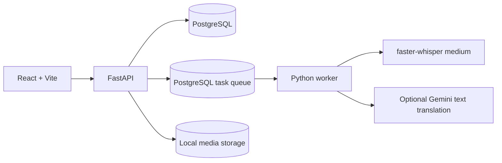

# Privacy-First AI Multilingual Subtitle Platform

Local-first subtitle generation and editing for English and Tamil, using server-side faster-whisper and a PostgreSQL-backed worker queue.

## Run locally (Windows, no Docker)

1. Install Python 3.11, Node.js, PostgreSQL 16, and FFmpeg (`ffmpeg` and `ffprobe` must be on `PATH`). Create a local PostgreSQL role/database matching `DATABASE_URL` in `.env.example`, or use your own local connection.
2. Copy `.env.example` to `.env` only if you do not already have a `.env`. Set `DATABASE_URL`, `JWT_SECRET`, and admin credentials. `WHISPER_MODEL=medium` is the default; `WHISPER_DEVICE=auto` selects CUDA when available and CPU int8 otherwise.
3. From the repository root, create/use the Python environment, install backend ASR dependencies, install frontend dependencies, and apply migrations:

   ```powershell
   py -3.11 -m venv backend\.venv311
   backend\.venv311\Scripts\python.exe -m pip install -e "backend[asr]"
   Push-Location frontend; npm ci; Pop-Location
   $env:PYTHONPATH = "$PWD\backend"
   backend\.venv311\Scripts\python.exe -m alembic -c backend\alembic.ini upgrade head
   ```

4. In three PowerShell terminals opened at the repository root, run the API, worker, and frontend:

   ```powershell
   $env:PYTHONPATH = "$PWD\backend"
   backend\.venv311\Scripts\python.exe -m uvicorn app.main:app --app-dir backend --reload --host 127.0.0.1 --port 8000
   ```

   ```powershell
   $env:PYTHONPATH = "$PWD\backend"
   backend\.venv311\Scripts\python.exe -m app.workers.runner --queue default
   ```

   ```powershell
   Push-Location frontend
   npm run dev -- --host 127.0.0.1
   ```

5. Open `http://localhost:5173`; check the API at `http://localhost:8000/health`. Sign in with the admin credentials from `.env`. The first real transcription downloads the medium model; CPU-only machines run it in int8 mode and may take longer.

## Environment

| Variable | Purpose |
| --- | --- |
| `DATABASE_URL` | Local PostgreSQL connection (the async driver is selected automatically). |
| `JWT_SECRET`, `ADMIN_EMAIL`, `ADMIN_PASSWORD` | Local authentication and seeded admin account. |
| `STORAGE_ROOT`, `STORAGE_BACKEND` | Local media storage configuration. |
| `WHISPER_MODEL`, `WHISPER_DEVICE` | faster-whisper model and `auto`, `cuda`, or `cpu` device selection. |
| `GEMINI_API_KEY`, `GEMINI_MODEL`, `GEMINI_RPM` | Optional text translation and transliteration. |
| `FAKE_ASR`, `FAKE_GEMINI` | Deterministic test engines; keep disabled for real processing. |
| `VITE_API_URL` | Frontend API origin; defaults to `http://localhost:8000`. |

## Architecture



See [docs/traceability.md](docs/traceability.md), [docs/deploy.md](docs/deploy.md), and [BUILD_LOG.md](BUILD_LOG.md) for architecture mapping, deployment notes, and build history.
